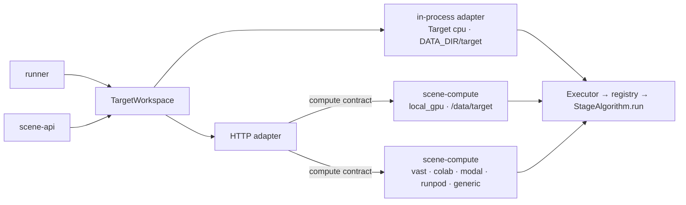

# Compute: Targets and the GPU server

Where Stages execute and how the worker talks to a GPU host. Read [overview.md](overview.md) first.

## Principle: one image, one HTTP contract

GPU providers have no common API: Modal speaks its Python SDK, RunPod its handlers, Vast.ai and
Colab hand you a machine. What all of them accept is a `linux/amd64` CUDA Docker image running an
HTTP server. So the system defines its own small HTTP contract, implements it once in
`scene-compute`, and ships that as one image. `TargetWorkspace` has a single remote adapter, HTTP.
Switching provider means deploying the same image there and pointing a Target at its URL;
Algorithms, the Executor, the server, the api and the worker never change.

## Targets

[compute.yaml](../../backend/config/compute.yaml) names the Targets. Each is either `inprocess`
(`cpu`: the process runs Algorithms itself on `DATA_DIR/target`) or `http` (URL, `X-Compute-Token`,
optional provider headers, `chunk_size` in bytes, `startup_timeout` and `poll_interval` in
seconds, `transfer_concurrency`). URLs and secrets come from `backend/.env` through `${VAR}`
expansion. `pipeline.yaml` picks one with its `target:` key.

`transfer_concurrency` (default 8) is how many files an upload sends, or a Publication downloads,
at once. Each request waits out the Target's round trip, which a tunnel stretches to seconds, so
moving one file at a time leaves the connection idle; `colab` uses 16. An upload request waits for
the Target's readiness once, not once per file. Every file is still checked against its SHA-256,
and the first failure cancels the transfers not yet started. The api or the worker can hold up to
`transfer_concurrency` chunks of `chunk_size` bytes in memory at once.

Every scene-compute response of 1 KB or more is gzip-compressed for a client that accepts it, except
Range (206) responses, so the worker fetches a file that fits one chunk whole. On a Colab tunnel the
downlink, not latency, limits a Publication: gzip takes `mesh.glb` to about 40% and
`scene_graph.json` to about 10%, while `points.ply` (binary floats) and `objects.npz` barely shrink.

Backend values are `inprocess` and `http`; `cpu` is a Target name, not a backend alias.

## Target Workspace

`TargetWorkspace` ([scene_target](../../backend/packages/scene-target/src/scene_target/__init__.py))
is the only way the api and the worker reach a Scene's Target Workspace. `open_target_workspace`
builds it once per runtime from the pipeline, the compute configuration, `DATA_DIR` and a readiness
timeout. It raises `ValueError` naming what to set in `backend/.env` when the Target variable is
unset, the Target is unknown or an HTTP Target has no URL; the worker then refuses to start and the
api answers `COMPUTE_UNAVAILABLE`.

| Call | Used by | Does |
|---|---|---|
| `put_inputs`, `list_inputs`, `remove_inputs` | api uploads | Uploaded files under `raw/`, on the Target only; a failed `put_inputs` may leave some stored, so the api removes the whole batch |
| `clear_outputs` | runner | Delete Stage outputs, keep `raw/` |
| `run_stage` | runner | One Compute Run with the Stage's configured Algorithm and parameters |
| `replace_results` | runner | Download results, finish them as `DATA_DIR/scenes/{id}/{version}`, call `publish`, then remove older versions |
| `embed_text` | api search | Query text through the embed Stage's Algorithm |
| `delete` | api Scene delete | Delete the Target Workspace on the current Target only |

Two adapters sit behind it. The in-process adapter runs the Executor on `DATA_DIR/target`; the HTTP
adapter speaks the compute contract below. Neither works in `DATA_DIR/scenes`, so a failed Job
never touches the published results. Every failure leaves as a `SceneError`: a failed Compute Run
keeps the Algorithm's `code` and `details`, a rejected request keeps the contract's code, and an
unreachable Target is `COMPUTE_UNAVAILABLE` (HTTP 503). The api builds its `TargetWorkspace` with a
10 s readiness timeout, so uploads and search wait briefly for a cold Target. Tests pass a
`TargetWorkspace` whose HTTP client is a `TestClient` of the scene-compute app;
[test_target.py](../../backend/tests/test_target.py) runs every case on both adapters.

## The compute contract

Rules every `scene-compute` deployment satisfies
([server.py](../../backend/services/scene-compute/src/scene_compute/server.py)):

1. Listens on `0.0.0.0:${PORT}` (default 9000).
2. Every request finishes within the configured request timeout (default 29 s, configurable
   via `REQUEST_TIMEOUT_S` on the server and `timeout` on `TargetConfig`, e.g. 300 s on Colab); long
   work runs as an asynchronous Compute Run and is polled.
3. Every request and response body is at most the chunk size (default 25,000,000 bytes, up to
   100,000,000 bytes on Colab, under RunPod Serverless's 30 MB limit). Files move in chunks.
4. App auth is `X-Compute-Token`, checked against `COMPUTE_TOKEN` on every path except `/ping`;
   `Authorization` stays free for the provider's own key.
5. Errors use the API's shape, `{"error": {"code", "message"}}`. A failed Compute Run's `error`
   also carries the Algorithm's `details`. Paths are checked against traversal.

| Method | Path | Purpose |
|---|---|---|
| GET | `/ping` | Readiness |
| GET | `/info` | Image version, GPU name, registered Algorithms |
| GET | `/workspaces/{scene_id}/files?dirs=a,b` | List files with `size` and `sha256` |
| PUT | `/workspaces/{scene_id}/files/{path}?offset=&total=&sha256=` | Write one chunk; the last chunk verifies the checksum |
| GET | `/workspaces/{scene_id}/files/{path}` | Download: a file within `chunk_size` whole, gzip-compressed when the client accepts it; a larger one with `Range` for chunks, never compressed |
| DELETE | `/workspaces/{scene_id}/files?dirs=a,b` | Delete Stage outputs before a Job |
| DELETE | `/workspaces/{scene_id}` | Delete a Scene's Workspace (on Scene delete) |
| POST | `/runs` | `{algorithm, scene_id, params}` → `202 {run_id}` |
| GET | `/runs/{run_id}` | `{state: queued\|running\|done\|failed, manifest?, error?, progress?}` |
| POST | `/invoke/{algorithm}/{method}` | Short synchronous call, e.g. `embed_text` |

The `local_gpu` Compose service keeps its Target Workspaces in `/data/target` on the shared volume
(`DATA_DIR=/data/target`) and is reached over HTTP like any other Target. Compute Runs run one at a time per server. A restarted server marks stale runs
`COMPUTE_INTERRUPTED`; with `CLEAN_ON_START=1` (set by the Colab notebook) it also deletes
`DATA_DIR/scenes` and `DATA_DIR/runs` on start.

At import, `scene_compute` sets `HF_HOME=$MODELS_DIR/hf` and `TORCH_HOME=$MODELS_DIR/torch`, so a
provider only needs to mount a folder at `MODELS_DIR` for the weight cache.

`scene_compute.download_models` reads `MODELS_PIPELINE_CONFIG` when set, otherwise the real
`pipeline.yaml` in `CONFIG_DIR` (or the shared source-layout resolver). An explicit missing path
fails instead of silently selecting a different configuration.

## Providers

| Provider | How it runs the image | Notes |
|---|---|---|
| Local GPU | Compose profile `local-gpu` of [compose.yaml](../../compose.yaml) (`uv run main.py up-local-gpu`, which also starts the `backend` and `frontend` profiles) | Needs the NVIDIA Container Toolkit. No token. |
| Vast.ai | Rented machine, SSH launch mode, On-start script starts uvicorn | First provider exercised live. URL changes per rental; SSH tunnel for real captures. [Runbook](../../backend/deploy/vast/README.md) |
| Google Colab | Notebook runs the server behind a Cloudflare Tunnel | Disposable: a runtime restart loses uploads. [Guide](../../backend/deploy/colab/README.md) |
| Modal | `Image.from_dockerfile` built remotely, `@modal.web_server` | No registry push. [Guide](../../backend/deploy/modal/README.md) |
| RunPod Pod / Serverless | Registry image; Serverless via the load-balancing endpoint | 100 s / 5.5 min request limits; token mandatory behind the proxy. [Guide](../../backend/deploy/runpod/README.md) |
| Any Docker host | `docker run --gpus all -p 9000:9000 …` | [Guide](../../backend/deploy/generic/README.md) |

Modal, RunPod and generic hosts are written but not exercised during development. Live results
go in [GPU-INTEGRATION.md](../GPU-INTEGRATION.md#live-check-log).

## The GPU image

[compute.Dockerfile](../../backend/docker/compute.Dockerfile), built from the repository root. Empty
`EXTRAS` gives the light **fake** image (contract fakes, for testing a provider connection);
`EXTRAS=gpu` gives the **gpu** image with every real Algorithm (the `gpu` extra in
[scene-compute/pyproject.toml](../../backend/services/scene-compute/pyproject.toml), which also pins
Torch for xformers). Build and push with `uv run main.py push-compute-image [--extras gpu]`; tags are
`{fake|gpu}-<git short sha>` under `COMPUTE_IMAGE_REPO`.

The Executor keeps every loaded model in VRAM, so a GPU Target needs at least 48 GB; more than
80 Keyframes in one DA3 pass need 80 GB ([ADR-0002](../adr/0002-single-gpu-image-ultralytics-sam3.md)).

Licenses accepted for this learning project: Ultralytics is AGPL-3.0, DA3 Nested Giant is
CC BY-NC 4.0 ([ADR-0002](../adr/0002-single-gpu-image-ultralytics-sam3.md),
[ADR-0003](../adr/0003-depth-anything-3-point-cloud.md)).
