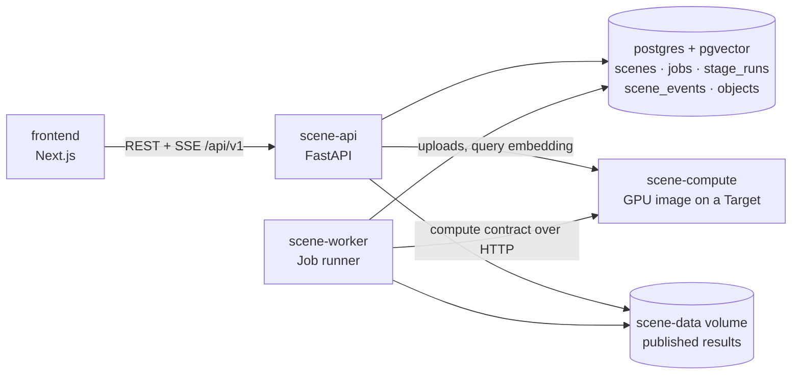

# Architecture overview

Start here. This page is the map: what the system is made of, how one Scene flows through it, and
where each part lives in the code. The other pages in this folder go deeper into one area each.
Domain terms (**Scene**, **Stage**, **Target**, ...) are defined in [CONTEXT.md](../../CONTEXT.md).

## The system in five sentences

1. A user creates a **Scene**, uploads photos or a short video of one room, and presses Process.
2. `scene-api` queues a **Job**; `scene-worker` picks it up and runs nine **Stages** in order, each
   as a **Compute Run** on one **Target** (a GPU host in the real pipeline, in-process on CPU in the
   fake one).
3. Every Stage is an **Algorithm**: a pure transform that reads folders of the Scene's **Workspace**
   and writes new ones. Algorithms never touch the database.
4. After the last Stage the worker downloads only the results and **publishes** the **Scene Graph**
   and Object embeddings into Postgres; the Scene becomes `ready`.
5. The Next.js frontend shows the room as a 3D point cloud, searches Objects by free text and answers
   questions through an LLM agent whose numbers all come from geometric tools.

## Services



| Service | Code | Role |
|---|---|---|
| `frontend` | [frontend/](../../frontend/) | Upload, live progress, 3D viewer, search, measuring, chat. Talks only to `scene-api`. |
| `scene-api` | [scene_api/main.py](../../backend/services/scene-api/src/scene_api/main.py) | REST + SSE, Scene lifecycle rules, search, QA agent ([qa.py](../../backend/services/scene-api/src/scene_api/qa.py)). |
| `scene-worker` | [scene_worker/runner.py](../../backend/services/scene-worker/src/scene_worker/runner.py) | Claims Jobs from Postgres, runs Stages on the Target, fetches results, publishes. |
| `scene-compute` | [scene_compute/server.py](../../backend/services/scene-compute/src/scene_compute/server.py) | The portable GPU server: one Docker image, one HTTP contract, any provider. |
| `postgres` | [backend/migrations/](../../backend/migrations/) | Relational state, the Job queue, progress events and pgvector embeddings. |

The only boundary between frontend and backend is HTTP. The frontend never reads files or the
database directly; every file URL it uses comes from the API.

## Life of a Scene

```mermaid
sequenceDiagram
  participant W as frontend
  participant A as scene-api
  participant P as postgres
  participant K as scene-worker
  participant C as Target (scene-compute)

  W->>A: POST /scenes
  W->>A: POST /scenes/{id}/uploads
  A->>C: stream each file into the Workspace's raw/
  W->>A: POST /scenes/{id}/process
  A->>P: INSERT job (queued)
  K->>P: claim job (FOR UPDATE SKIP LOCKED, polled every 0.5 s)
  K->>C: delete previous Stage outputs, keep raw/
  loop each of the nine Stages
    K->>C: POST /runs, then poll GET /runs/{run_id}
    K->>P: SceneStore: stage_runs + scene_events in one transaction
    A-->>W: SSE stage / progress events (API reads scene_events)
  end
  K->>C: download Scene Results (graph, embeddings, mesh, recon/rgb)
  K->>P: publish Objects, Relations, embeddings; Scene ready
  W->>A: GET /objects, /search, POST /queries
```

Intermediate outputs (keyframes, depth, masks, Instances) stay on the Target; only the results come
back to local storage ([ADR-0005](../adr/0005-whole-pipeline-on-gpu-host.md)). A processed Scene stays
viewable with the GPU host off; search and the QA tool `find_objects` need it running because query
text is embedded there.

## Code map

The backend is one uv workspace ([pyproject.toml](../../pyproject.toml) at the repository root).
Packages depend downward only:

```
scene-core     domain models, Workspace contracts, ports, registry, Executor, config, pure-NumPy geometry
   ▲
scene-stages   one Algorithm per Stage method + one fake per Stage; heavy deps as optional extras
scene-store    every state write and the scene_events outbox (Postgres); depends on scene-core only
scene-target   TargetWorkspace: the pipeline's one Target, in-process or over HTTP
   ▲
scene-api · scene-worker · scene-compute     runtimes and adapters
```

`scene-core` never imports `torch`, `fastapi` or a database driver.

| Looking for | File |
|---|---|
| Stage order, Workspace folders, Manifests | [scene_core/contracts.py](../../backend/packages/scene-core/src/scene_core/contracts.py) |
| Published result files, public paths, `EMBEDDING_DIM` | [scene_core/results.py](../../backend/packages/scene-core/src/scene_core/results.py) |
| Scene, Object, Relation, Scene Graph models | [scene_core/domain.py](../../backend/packages/scene-core/src/scene_core/domain.py) |
| Error codes | [scene_core/errors.py](../../backend/packages/scene-core/src/scene_core/errors.py) |
| Loading `pipeline.yaml` / `compute.yaml` | [scene_core/config.py](../../backend/packages/scene-core/src/scene_core/config.py) |
| Algorithm lookup by name | [scene_core/registry.py](../../backend/packages/scene-core/src/scene_core/registry.py) + entry points in [scene-stages/pyproject.toml](../../backend/packages/scene-stages/pyproject.toml) |
| Running one Algorithm | [scene_core/executor.py](../../backend/packages/scene-core/src/scene_core/executor.py) |
| Real GPU Algorithms (DA3, GeoCalib, SAM 3, MetaCLIP 2) | [scene_stages/gpu.py](../../backend/packages/scene-stages/src/scene_stages/gpu.py) |
| CPU Algorithms | `scene_stages/` [ingest.py](../../backend/packages/scene-stages/src/scene_stages/ingest.py), [mesh.py](../../backend/packages/scene-stages/src/scene_stages/mesh.py), [lift.py](../../backend/packages/scene-stages/src/scene_stages/lift.py), [attributes.py](../../backend/packages/scene-stages/src/scene_stages/attributes.py), [graph.py](../../backend/packages/scene-stages/src/scene_stages/graph.py) |
| Fake Algorithms for tests and the walking skeleton | [scene_stages/fake.py](../../backend/packages/scene-stages/src/scene_stages/fake.py) |
| Target selection, uploads, Stage execution, result replacement | [scene_target](../../backend/packages/scene-target/src/scene_target/__init__.py) (`TargetWorkspace`, in-process and HTTP adapters) |
| State writes, migrations, event replay | [scene_store](../../backend/packages/scene-store/src/scene_store/__init__.py) |
| API request/response models (exported to OpenAPI) | [scene_api/models.py](../../backend/services/scene-api/src/scene_api/models.py) |
| Tests | [backend/tests/](../../backend/tests/), `frontend/src/**/*.test.ts(x)` |

## Configuration

Four files decide what runs where; changing provider or method is a configuration change.

| File | Decides |
|---|---|
| [backend/config/pipeline.yaml](../../backend/config/pipeline.yaml) | Algorithm, Target and parameters per Stage (real models). [pipeline.fake.yaml](../../backend/config/pipeline.fake.yaml) runs fakes in-process; [pipeline.fake-gpu.yaml](../../backend/config/pipeline.fake-gpu.yaml) runs fakes on a remote Target. |
| [backend/config/compute.yaml](../../backend/config/compute.yaml) | The named Targets (`cpu`, `local_gpu`, `vast`, `colab`, `modal`, ...) and how to reach them. |
| [backend/.env.example](../../backend/.env.example) | `PIPELINE_CONFIG`, `GPU_TARGET`, Target URLs, `COMPUTE_TOKEN`, LLM endpoint. Copied to `backend/.env`. |
| [compose.yaml](../../compose.yaml) | The one Compose file: every service, grouped into the profiles `backend`, `frontend` and `local-gpu` that `main.py up` starts. |

No GPU provider is the default: `GPU_TARGET` must name a Target, or the worker refuses to start.

## Where data lives

| Data | Location | Survives `main.py reset`? |
|---|---|---|
| Uploads and intermediate Stage outputs | The Target's disk (`DATA_DIR/scenes/{id}/`) | No (and lost when a rented GPU host is destroyed) |
| Published results (`graph/`, `embeddings/`, `mesh/`, `recon/rgb/`) | `scene-data` volume, `/data/scenes/{id}/{job id}/` ([ADR-0006](../adr/0006-versioned-publication.md)) | No |
| Scenes, Jobs, Stage Runs, events, Objects, Relations, chat | `postgres-data` volume | No |
| Model weights | Host folder `./models` (bind mount at `MODELS_DIR`) | Yes |

The frontend stores nothing.

## Conventions

- All code, identifiers, logs, API messages and docs are English; only UI strings are localized
  (`frontend/messages/en.json`, `vi.json`).
- Units are SI; coordinates are z-up with the floor at z = 0 after the align Stage.
- Algorithm names are `<stage>.<method>` (`recon.da3`); REST paths are plural kebab-case nouns;
  JSON, tables and columns are snake_case; error codes are UPPER_SNAKE_CASE.
- Learning project: no fallbacks when a component fails, no benchmarks.

## Where to go next

| You are working on | Read |
|---|---|
| A Stage, its inputs/outputs, the Job runner or Publication | [pipeline.md](pipeline.md) |
| Targets, the compute contract, the GPU image or a provider | [compute.md](compute.md) |
| REST endpoints, SSE, lifecycle rules, schema or the QA agent | [api.md](api.md) |
| The web UI | [frontend.md](frontend.md) |
| Adding or replacing an Algorithm, Relation, QA tool, layer or provider | [extending.md](extending.md) |
| Why something is the way it is | [docs/adr/](../adr/) |
